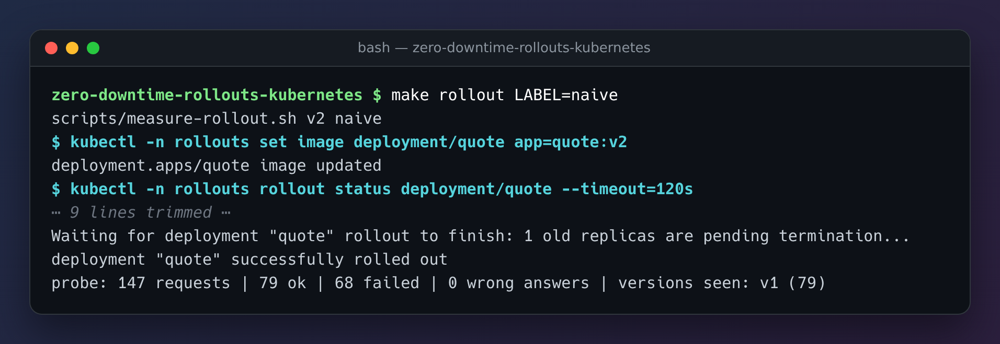
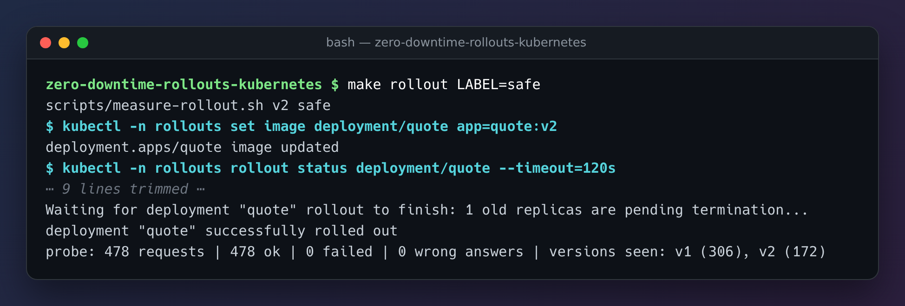
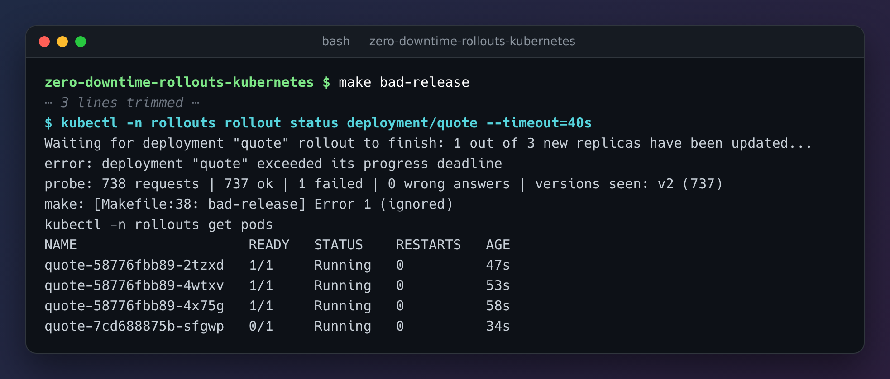
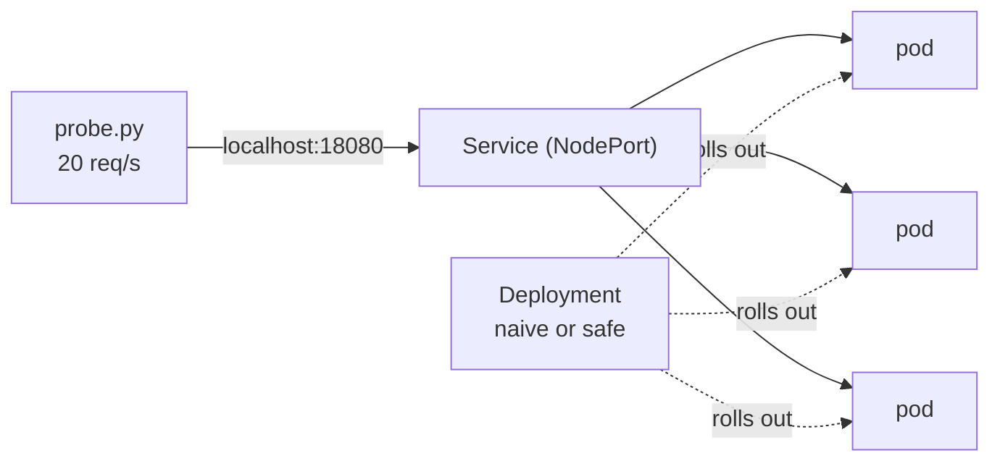

# zero-downtime-rollouts-kubernetes

[](https://github.com/MoYusuf1/zero-downtime-rollouts-kubernetes/actions/workflows/ci.yml)

I measured what users see during a Kubernetes rollout, then changed two settings that affect traffic until errors were rare. It runs on a local kind cluster, and CI runs the same drill on every push.

With no readiness probe, a rollout failed about half of all requests for about 4 seconds (measured windows in `notes.md`) while Kubernetes reported "successfully rolled out". With a readiness probe and a `preStop` sleep, the same rollout failed 3 requests out of 2,380 across five runs. A release that answered "healthy" but quoted the wrong price failed the readiness check's known test case, never became Ready, and sent 0 wrong answers to the probe.

## Results

kind v0.33.0, Kubernetes v1.37.0, 3 nodes, 3 replicas. A probe sends about 20 requests a second through the Service. Raw notes are in `notes.md`.

| Drill | Runs | Requests | Failed | Wrong answers |
| --- | --- | --- | --- | --- |
| Naive rollout, v1 to v2 | 4 | 595 | 284 (68, 73, 72, 71) | 0 |
| Safe rollout, v1 to v2 | 5 | 2,380 | 3 (0, 0, 1, 0, 2) | 0 |
| Bad release (health 200, quote 999) | 4 | 2,916 | 1 (1, 0, 0, 0) | **0** |

| Naive rollout | Safe rollout |
| --- | --- |
|  |  |



The safe-rollout failures were connection resets about 2 s after the rollout started, before the first new pod was ready. I have not found the cause. All ten screenshots are in [`screenshots/`](screenshots/).

## What it does



| File | What it is |
| --- | --- |
| `app/` | A Go API (15 MB image). `/quote` returns a price, `/healthz` says the process is up, `/readyz` checks that a known test case returns 1200. Each pod needs 5 s to warm up |
| `k8s/deployment-naive.yaml` | 3 replicas, no readiness probe |
| `k8s/deployment-safe.yaml` | The same, plus a readiness probe, a 5 s `preStop` sleep and a 30 s progress deadline |
| `scripts/probe.py` | Counts ok, failed and wrong answers while a rollout runs |
| `scripts/measure-rollout.sh` | Starts the probe, runs `kubectl set image` and `rollout status`, prints the counts |
| `scripts/e2e.sh` | The whole drill. Fails if any wrong answer reaches users, or if 1% or more of requests fail |

## Why the safe settings work

- **Readiness probe.** Without one, a pod joins the Service when its container starts, before the app can answer. Here `/readyz` also checks one known test case (it must return 1200), so a release that gets that case wrong never joins. A bug that only affects other inputs would pass.
- **`maxUnavailable: 0`.** Already the default for 3 replicas (25% rounds down to 0). It is written out so it stays 0 if the replica count changes.
- **`preStop` sleep.** A stopping pod keeps answering for 5 s while it is removed from the Service.
- **`progressDeadlineSeconds: 30`.** It does not change traffic. A stuck rollout reports itself after 30 s, which is how the bad release showed up.

## How it's tested

| Check | Where | What it proves |
| --- | --- | --- |
| `make check` | CI and locally | The manifests are valid (kubeconform `-strict`), and the Go tests pass |
| `make e2e` | CI on a kind cluster, and locally | One full run. The test fails if any wrong answer reaches the probe, if 1% or more of requests fail, or if the app is not healthy after `rollout undo`. It allows a few failures because of the unexplained resets above |

## Run it

Run the steps in order: `make undo` goes back to the version before the bad release, which is v2 only after the safe rollout. You need Docker, kind, kubectl, make, curl and Python 3. Port 18080 must be free: `ss -ltn | grep 18080` should print nothing. `cluster/kind.yaml` maps it to the app's NodePort.

```bash
make cluster images
```
```bash
make deploy-naive && make rollout LABEL=naive
```
```bash
make deploy-safe && make rollout LABEL=safe
```
```bash
make bad-release && make undo
```
```bash
make down
```

Each `make rollout` ends with a line like `probe: 478 requests | 478 ok | 0 failed | 0 wrong answers`, and saves every request to `evidence/<label>.jsonl`.

Or run everything with checks in one step: `make e2e`. It creates its own cluster and deletes it at the end, so run it with no cluster called `rollouts`.

## Limits

- One machine, a 5 s simulated warm-up, and no database. A real app with schema changes needs more than this before a rollback is safe.
- About 20 requests a second, not production load.
- The cluster uses kube-proxy in nftables mode.

## What I would add next

- A `PodDisruptionBudget` and a node drain during the rollout.
- An HPA, so the drill runs while the replica count changes.
- The same drill on a managed cluster.

## License

MIT
